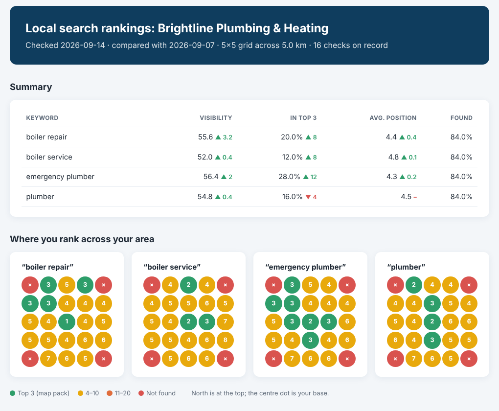
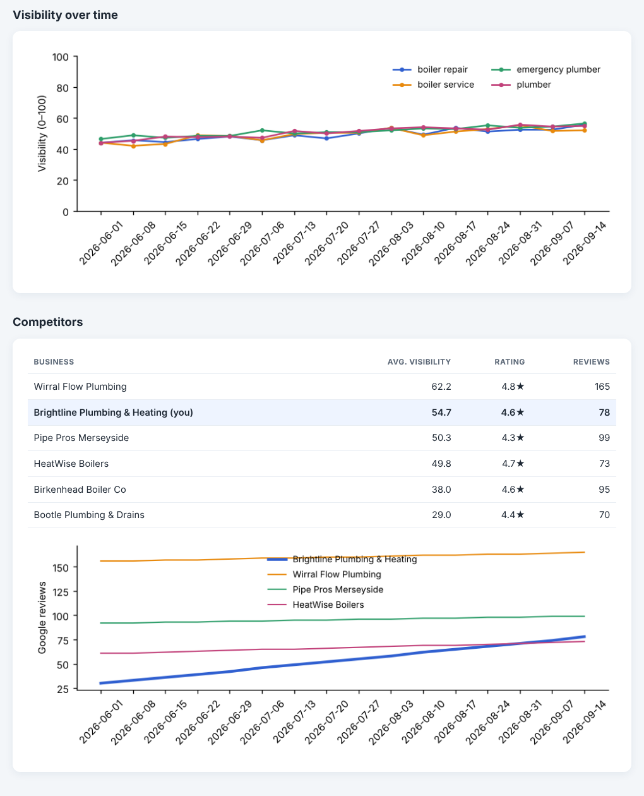

# Local SEO Rank Tracker


Track how a local business ranks on Google **across its whole service area**, how its reviews compare with competitors', and how both change week by week. Every check produces a **client-ready HTML report** that can be emailed automatically.

Built for the tradespeople and small businesses I work with at [Wallasey WebWorks](https://wallaseywebworks.co.uk). For a plumber, ranking #1 at the office means little if they're #8 two miles away, where half their customers live.



## Features

- **Geo-grid rank tracking:** searches every keyword from a grid of points (up to 9×9) around the business, the way customers in different streets actually see results. Each grid is shown as a colour-coded map.
- **Clear local metrics:**
  - **Visibility (0–100):** #1 scores 100, each place lower loses 10 points, and #11 or lower scores 0. Averaged over the grid.
  - **Top-3 share:** how much of the area sees the business in Google's map pack.
  - **Average position** and **coverage** (where it appears at all).
- **Week-on-week change** for every metric, with up and down arrows.
- **Competitor tracking:** finds who holds the map pack automatically (or follows the businesses you name) and compares visibility, ratings and **review growth** over time.
- **Plain-English next steps,** e.g. *"Wirral Flow Plumbing has 102 more reviews. Ask every happy customer for a review…"*
- **History in SQLite,** so trends build up over weeks and months. Re-running a check on the same day replaces that day's data instead of duplicating it.
- **Two data sources:**
  - `google`: the official **Google Places API** (Text Search), with results biased to each grid point.
  - `demo`: a simulated local market with 16 businesses, so you can try everything without an API key.
- **Automation:** `rank-tracker email` sends the report over SMTP. [`examples/weekly-check.yml`](examples/weekly-check.yml) runs a check every Monday on GitHub Actions and emails the client.



Full example: [`docs/example-report.html`](docs/example-report.html) (download it and open it in a browser).

## Quick start

```bash
git clone https://github.com/volaitan/local-seo-rank-tracker.git
cd local-seo-rank-tracker
python -m venv .venv && source .venv/bin/activate
pip install -e ".[dev]"

rank-tracker init                 # creates tracker.toml (demo provider)
rank-tracker demo --weeks 16      # 16 weeks of simulated history
rank-tracker report               # writes report.html
```

### Tracking a real business

1. Get a Google Maps Platform API key with the **Places API (New)** enabled, then `export GOOGLE_MAPS_API_KEY=...`.
2. In `tracker.toml`, set `provider.name = "google"` and fill in the grid centre, radius and keywords.
3. Find the business's place id with `rank-tracker find "Business Name, Town"` and add it to the config.
4. Run `rank-tracker check` each week (or use the scheduled workflow), then `rank-tracker report`.

A 5×5 grid with 4 keywords makes 100 API calls per check, so check Google's current pricing and free allowance before scheduling it.

```toml
keywords = ["plumber", "emergency plumber", "boiler repair"]

[business]
name = "Your Business"
place_id = "ChIJ..."

[grid]
lat = 53.4239
lng = -3.0485
radius_km = 5
size = 5

[provider]
name = "google"
```

## Commands

| Command | What it does |
|---|---|
| `rank-tracker init` | Create an example `tracker.toml` |
| `rank-tracker find "query"` | List businesses and their place ids |
| `rank-tracker check [--date YYYY-MM-DD]` | Search every keyword from every grid point and store the results |
| `rank-tracker demo --weeks N` | Record N weeks of simulated checks |
| `rank-tracker report [--out file]` | Build the HTML report |
| `rank-tracker email --to address` | Email the report (needs `SMTP_HOST`, `SMTP_USER` and `SMTP_PASSWORD` set) |

## Architecture

```
src/rank_tracker/
├── config.py      # TOML config, validation, geo-grid maths
├── providers.py   # GoogleProvider (Places API) and DemoProvider, behind one interface
├── tracker.py     # Runs a check across the grid (thread pool)
├── storage.py     # SQLite history
├── metrics.py     # Visibility, top-3 share, average position, change labels
├── report.py      # Charts (matplotlib, embedded as images) and suggestions
├── templates/report.html
└── cli.py
tests/             # 18 pytest tests
```

Ranking sources sit behind a small `Provider` interface, so adding another source (such as a SERP API) means writing one class. The Google provider is tested with a fake HTTP session that checks the exact request format, so the tests never call the real API.

## Licence

MIT
